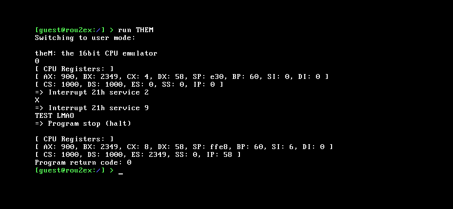

# theM

A 16-bit CPU emulator to be (MS-)DOS-friendly eventually.

It runs real mode 8086/80186/286 code with the parts of a PC around it that a
DOS program expects: the interrupt vector table, the BIOS and DOS service
calls, the 8259 interrupt controller, the 8253 timer, the keyboard
controller, the PC speaker and an EGA/VGA display adapter with its bit
planes.

## Preview



*^ Emulator's baby steps: Simple 16-bit x86 assembly program execution ---
emulated as a whole.*

## Usage

To build this app, `gcc`, `ld.lld`and `nasm` tools are required. Ensure having
these installed before building itself.

```shell
make build
```

This build procedure will produce the `THEM.ELF` executable. This file
can be added to the app collection on some floppy medium/image then.

Put the emulator and the program to run on a floppy:

```shell
dd if=/dev/zero of=fat.img bs=512 count=2880
mkfs.fat -F 12 fat.img
mcopy -i fat.img them.elf ::THEM.ELF
mcopy -i fat.img vlak.com ::VLAK.COM
```

Boot [r2](https://github.com/krustowski/rou2exOS) and run a program with:

```r2
fg them VLAK
```

Both `.COM` and `.EXE` programs run. A name without an extension is
resolved the way DOS resolves one -- `.COM` first, then `.EXE` -- which also
keeps the command inside the 12 character argument limit of the `run`
command. What a file actually is comes from its contents, not its name: an
image starting with the `MZ` signature is loaded as a relocatable
executable and everything else as a flat `.COM`.

Use `--org OFFSET` before the program name to load a flat image at a custom
offset and start execution there. The default is `0x100`; offsets accept
decimal or hexadecimal with a `0x` prefix. For a program assembled with
`ORG 0`, for example:

```r2
fg them --org 0x000 ROUREXS.COM
```

The offset is within the program's segment (`0x1000`), which is also the
initial CS, DS, ES and SS. An offset below `0x100` lets the image replace the
DOS PSP, including its command tail and environment pointer. The image must
fit below the initial stack word at `0xFFFE`; a larger image is rejected.
`.EXE` files use the entry point in their header, and programs started by DOS
EXEC still load at the usual `0x100` offset.

BIOS disk calls see an empty, read-only 1.44 MB FAT12 floppy on drive A:.
Reset, status, CHS reads, verification and geometry queries are emulated;
sector writes report write protection. This lets a standalone kernel such
as ROUREXS.COM read a valid boot record and start its shell with `--org 0`.
Its floppy contains no host files. DOS `INT 21h` file calls continue to use
the host filesystem.

The workstation harness can check that kernel's startup and `help` command
in both console and window modes:

```shell
make -C host rourexs-test ROUREXS=/path/to/ROUREXS.COM
```

Everything after the program name becomes the guest's command tail, and the
word `debug` turns on the emulator's own tracing:

```r2
fg them VLAK debug
```

The word `log` instead leaves a record of the run in `/mnt/fat/THEM.LOG`:

```r2
fg them DYNA log
```

Tracing every interrupt to the screen costs more than a game can afford, and
a run that goes wrong minutes in has nothing to say to a screen the guest
owns anyway. The log is written to the floppy every few seconds instead, so
it can be read over telnet while the emulator is still stuck, or after the
next boot if it is not. It records the allocations, the files the guest
opens, closes and reads short, and once a second a heartbeat:

```
[19978] open /mnt/fat/DYNA/gfx/19.img size=22352 -> h=5
[20110] hb steps=10678272 frames=2608 cs=1010 ip=5a5 mode=12 hlt=0
```

The heartbeat is there because the ways this goes wrong look alike from
outside. `steps` stuck is a guest that has stopped executing, `frames` stuck
is a display that has stopped being presented, a gap in the timestamps with
both frozen is the emulator not getting back out of a syscall. Runs append,
and the file starts over once it passes 192 KiB.

There is a fourth way, which looks like the first and is not: a guest that is
executing, but only in the time the display leaves it. `gfx=` carries both
the milliseconds spent presenting and what the last frame cost, so the two
can be told apart. `steps` crawling while `gfx` accounts for most of the
second is not a stuck guest, it is a starved one -- see **Paying for the
picture** below.

**F12 quits the emulator**; the key never reaches the guest. A program that
ends the way DOS programs do -- `INT 20h`, or `INT 21h` with `AH=4Ch` --
returns to the shell on its own. `HLT` does what it does on real hardware:
it waits for the next interrupt and then carries on.

### Example

Sample program `PRG0` demonstrates the functionality of some opcodes
and instructions implementations already done. It is very easy
to assemble using NASM:

```shell
nasm -f bin -o prg0.bin prg0.asm 
```

## In a Memento window

memento-hello's file manager runs a program in theM in a window of its own:
Enter on an `.EXE` or `.COM`, or Alt+Space and **Run in theM**. The window
starts `them.elf --host 0x<block> /mnt/tar/games/DIR/GAME.EXE` with the
address of a block it allocated on the user heap (`winhost.h`), and in that
mode the emulator leaves the hardware alone: no VGA mode sets, no framebuffer
blits, no console output and no keyboard pipe, any of which would be done over
Memento's head. Each picture -- text mode drawn with the kernel font -- goes
into the block in Memento's colours (the 16 EGA ones, or those and its 6x6x6
cube and greys on the framebuffer), DOS and BIOS console output is written
into the guest's own text screen, and the keys arrive through the block as the
scancodes the keyboard sent. The program starts in its own directory. F12
still ends it; closing the window does too.

`--org` also works with `--host`; for a zero-origin flat image the launch
command is `them.elf --host 0x<block> --org 0x000 /mnt/tar/ROUREXS.COM`.
In Memento's Files window, choose **Start at offset...** from a `.COM`
file's context menu and enter the offset. Enter starts the program; Esc
cancels, and Ctrl+A or Delete clears the input. Restarting the theM window
with Enter keeps the chosen offset.

If shutdown takes longer than the window's two-second wait, Memento keeps
ownership of the shared picture block in a pending cleanup list. Its main
loop frees the block once the emulator detaches or the task dies, including
while the login dialog is shown. This needs the updated Memento application
and r2 backend as well as the emulator.

Graphics frames are decoded straight into the window's indexed buffer. The
guest's DAC colours are matched to Memento's palette only when they change;
the attribute controller's colour banking and PEL mask are resolved once
per frame. This avoids converting every pixel to RGB and back, and avoids
building a 32768-colour lookup before the first graphics frame. The same
five-bit colour matching is used, so palette fades and cycling keep their
previous appearance.

Window frames start at most once every 20 ms. Their elapsed conversion time
can include Spotify or another process running while theM is preempted, so
it does not incur the extra rendering-budget delay used for full-screen
blits. Heartbeat timing syscalls also run only when logging is enabled.

## What is emulated

- **CPU**: the 8086 instruction set plus the 80186 additions (`PUSHA`,
  `POPA`, `BOUND`, `ENTER`, `LEAVE`, immediate `IMUL`, immediate shifts).
  Segment overrides, all `REP` forms, the string instructions and the flags
  each instruction actually defines. To a program that asks, it is a 286 in
  real mode: the top four flag bits read back as zeros, `0Fh` is the 286's
  opcode prefix rather than `POP CS`, and `SMSW` reports real mode. Plenty of
  games test for a 286 and refuse an 8086 outright -- Ugh! and Atomix among
  them -- while nothing a 286 adds in real mode was missing. A program that
  needs a 386 (DOS/4GW, and so Doom) is told there is none, and says so.
- **Interrupts**: every vector points at a stub that traps back into the
  emulator, so a guest can hook any vector -- the keyboard and timer above
  all -- and still chain to the original handler.
- **BIOS**: video (`INT 10h`), equipment and memory size, keyboard
  (`INT 16h`), the clock (`INT 1Ah`), and the `INT 08h`/`INT 09h` hardware
  handlers behind the timer and the keyboard.
- **DOS**: the `.EXE` loader -- image placement, the segment relocation
  table and the entry `CS:IP`/`SS:SP` -- and the `INT 21h` services -- console output,
  file handles, the file pointer, directory searches, memory allocation, the
  interrupt vector calls, the date and time, running another program and
  program termination. A guest writes a path the DOS way and it is
  translated on the way in: the one drive's root is r2's root, so
  `C:\MNT\FAT\GFX\19.IMG` is `/mnt/fat/GFX/19.IMG`, and `gfx/19.img` is read
  in the guest's own directory, which `AH=47h` names (`mnt\fat`). The root
  holds nothing but `MNT`, so `C:\19.IMG` finds nothing and a file cannot be
  created there -- nor on the CD or the archive: a create that could never
  be saved fails at once rather than losing the file at close. A program can
  keep its data in subdirectories the way it did on a hard disk. The padding comes out of an 8.3 name on the way in as well --
  DOS reads `HIGHSC  .CDM` and `HIGHSC.CDM` as the same eleven bytes, and a
  program that builds its filenames out of a padded table is counting on it. The program segment prefix carries an environment block and the
  program's own full path, which is where a program looks for the directory
  it was started from -- without one it reads segment zero as the environment
  and scans it forever.
- **Starting another program**: `AH=4Bh` keeps the parent where it is, loads
  the child above it and hands control back when the child ends. A parent
  that asks for the interpreter named in `COMSPEC` with `/C <command>` --
  which is how a program runs a command rather than a program -- has that
  unwrapped and the command run directly, there being no interpreter here.
  The child gets an environment of its own, ending in its own path.
  Its file table inherits references to the parent's open files and their
  current positions. Closing a child's reference preserves the parent's;
  termination flushes and releases any files the child leaves open.
- **Reading**: a file is never held whole. A program image is brought in a
  window at a time and a guest's own reads are served straight out of the
  file, so what a program can open is not bounded by what the emulator can
  hold: a 780 KiB `.EXE` whose load module is 120 KiB starts, and can go on
  reading its overlays out of the end of itself afterwards.
- **Hardware**: 8259 masking and end-of-interrupt, an 8253 timer that drives
  IRQ0 at whatever rate the guest programs -- ticks missed during a stall are
  caught up, but never while the previous tick's handler is still running,
  since a real timer never does that and plenty of handlers (Dangerous Dave
  in the Haunted Mansion's, for one) keep their stack pointer in a fixed
  variable and are not re-entrant -- the keyboard controller at ports
  0x60/0x64, and the PC speaker, which is passed through to the real one.
- **Display**: text mode, mode 13h, the 16-colour planar modes and the
  unchained 256-colour modes -- "Mode X" -- with the Sequencer, Graphics
  Controller, Attribute Controller and DAC registers, including the latches,
  the bit mask, set/reset and all four write modes. What the pixels mean is
  read back from the registers rather than taken from the BIOS mode number,
  because a game that wants Mode X asks the BIOS for 13h and then turns
  chain-4 off by hand; the picture's width, height and scan doubling come
  from the CRTC the same way. The frame is presented either through the VESA
  framebuffer, when the bootloader provided one, or by borrowing the VGA
  hardware in mode 13h. On the framebuffer it goes out at the size the guest
  is actually running and is stretched to fill the screen by the kernel's
  scaled blit; only the mode 13h fallback, which is 320x200 and cannot be
  anything else, still samples a wider mode down. That fallback takes the
  adapter back whenever the guest returns to a graphics mode, because a guest
  that asked for text mode was given the adapter and does not hand it back on
  its own -- a program with a setup screen goes graphics, text, graphics, and
  everything after the second switch was being painted into memory the CRT
  was no longer showing.

  The vertical retrace on port `3DAh` keeps real time, some 70 frames a
  second: a program that waits for it is counting frames, and a bit that
  toggled on every read made Ugh!'s half-minute menu last three milliseconds.
  Both pulse edges remain observable when the cached clock skips a blanking
  interval. Testing one exact millisecond in each period could miss every
  retrace with 2 ms polling and leave HAUNTED.EXE spinning forever. Missed
  frames produce one current pulse, with no backlog or accelerated clock.

  Which mode the fallback borrows follows the guest rather than being always
  13h. A 16-colour guest too big for 320x200 is shown in the hardware's own
  640x480 mode instead, plane for plane through the sequencer's map mask:
  the guest is already in four planes of exactly that shape, so the picture
  goes out at the size it was drawn and nothing is sampled. Sampling it into
  13h cost every other column and three rows in five, which a picture
  survives and a program's own 8x8 text does not -- four pixels wide and
  three tall is not writing any more. This is the path a text-mode boot
  takes, which is most of them: without a framebuffer there is no VESA to
  present through, and until now a 640x480 program was unreadable there
  however well it ran. The mode is chosen when the adapter is first borrowed
  rather than being set to 13h and corrected afterwards, so the display comes
  up once at the size it will keep -- a host that sizes a window to the first
  mode it is given would otherwise spend the rest of the run eighty lines
  short of the second.

## Developing on a workstation

`host/` builds the emulator as an ordinary Linux program, with `host.c`
standing in for the r2 syscalls. A guest can be run, screenshotted and
traced there in a second instead of through a boot of the operating system.

```shell
cd host && make
THEM_SHOTS=2000 THEM_KEYS="1500:0x1C,1600:0x9C" ./them-host ../vlak.com
```

| Variable | Meaning |
| -------- | ------- |
| `THEM_RUN_MS` | how long to let the guest run (default 4000) |
| `THEM_SHOTS` | comma separated ms marks to capture the screen at |
| `THEM_KEYS` | `ms:scancode` pairs to feed the keyboard |
| `THEM_OUT` | output path prefix for the captured frames |
| `THEM_BLIT_MS` | charge this many ms for presenting a frame |

`THEM_BLIT_MS` is there because presenting a frame is free on a workstation
and expensive on r2, so the one failure the harness could not reproduce was
the display starving the guest. Setting it to what r2 charges -- some 40 ms
for a full screen -- reproduces that in a second instead of a boot.

The `log` argument works here too and writes `THEM.LOG` beside the guest
rather than to a floppy that a workstation does not have.

`make -C host test` runs a small DOS guest that checks memory reuse,
resize boundaries, invalid frees, the drive media descriptor and single-step
traps, plus native checks of the VGA palette defaults, mode resets, colour
banks, PEL masking and BIOS/port DAC conversion. Window checks cover indexed
rendering against the RGB path, palette changes, 16/256-colour switching,
sampling and preservation of a buffer the window is reading. Lemmings needs
all three DOS memory calls (48h/49h/4Ah): it probes
memory with a large allocation, frees it, then allocates its sound driver and
game data. Its loader also decodes instructions using INT 1 single stepping,
and queries the drive's media descriptor through AH=1Bh. These now behave
as guest code expects.

Pacing checks simulate a pause during window conversion, verify that it
does not add another delay, keep the full-screen blit budget, and check that
disabled logging does not make diagnostic clock calls in the CPU loop.
Retrace checks cover coarse clock samples, both pulse edges, long pauses,
mode changes and the limit on how quickly frames can be counted.

Resource checks run 64 nested child/grandchild executions, reuse inherited
file numbers, verify shared positions and saved data, and exhaust the file
table afterwards to check that every slot was reclaimed. Grandchildren exit
inside a timer interrupt to verify that restoring the parent's CPU discards
abandoned child frames. IRQ checks pause an active handler for 251 ms,
one minute and one hour, then verify both IRET and RETF 2 returns. Window
lifetime checks retain blocks still in use and reclaim detached or dead
emulators without allocating during shutdown.

Screens are written as PPM. The whole guest megabyte is left behind in
`guest.bin` when the program stops, which is what to disassemble when a guest
goes somewhere unexpected. A program that unpacks itself and jumps elsewhere
-- which is most of them -- is not in its own segment by then, so cut out the
segment the heartbeat last reported and start there:

```shell
dd if=guest.bin bs=1 skip=$((0x1857 * 16)) count=65536 of=cs.bin
ndisasm -b16 -o0 cs.bin | less
```

## Notes on the host kernel

The emulator does not print. Its own messages -- a missing program, a
failed allocation -- are drawn on the screen with the kernel's font and
wait for a keypress. Console output and the serial line both make a syscall
wait on something that cannot be waited on safely with interrupts disabled:
the kernel's screen lock, held by whichever task printed last, and a UART
that may not be there. A program stuck in either takes the machine with it,
which is a poor way for an emulator to report that it could not open a file.

The floppy driver reports no errors and retries nothing, so a dropped
transfer arrives as a file full of zeros. Reads are retried here, and a
program image that comes back empty is read again rather than run.

Reading out of a subdirectory needs a kernel whose `read_file` walks every
component of the path. Older ones convert the whole string to a single 8.3
name, so `GFX/19.IMG` is looked up as a file of that name and never found;
a guest that loads its data from a subdirectory then hangs waiting for
something that never arrives. Flattening the program's files into one
directory is the way around that.

Reading at all needs `read_file_at`, the kernel call that takes an offset
and a length (syscall 0x39). Everything a guest reads goes through it,
program images included, because the call that does not take a length has no
way to say how much room the buffer has and writes the whole file whatever
the size. A kernel without it cannot run a guest here, and one whose
`read_file_at` knows only the floppy cannot run a guest off the CD.

A guest runs from either. The CD is a good deal slower: its blocks come off a
PIO drive with nothing cached behind them, and the path is walked from the
root of the disc on every read, so a game whose title screen arrives in a
couple of seconds from the floppy takes half a minute from `/mnt/iso`. It is
the waiting that differs and nothing else. The CD is also read-only, so a
guest that saves its settings or a high score gets an error where it expected
a file.

The working directory comes out of the kernel's configuration, which every
task shares. An older kernel, finding that lock held at the instant it was
asked, wrote nothing and reported success, and resolved a relative name
against the root in the same case -- so a guest started at such a moment went
looking for its files in the root, and only sometimes, which is the hardest
kind of failure to see. The emulator clears the buffer, asks again while the
answer is empty, and hands the kernel nothing but absolute names; the kernel
now waits for the lock and answers `Busy` when it cannot get it.

## Paying for the picture

Presenting a frame is not free and is not the emulator's to price. The
kernel's scaled blit writes the whole framebuffer whatever size the guest is,
so on a 1024x768 screen one frame is three quarters of a million pixels --
about 40 ms -- however little of the picture changed. A frame every 20 ms is
then a promise that cannot be kept: the display takes the whole run and the
guest gets what is left, which in a measured case was a tenth of it. A game
whose logic runs at a tenth speed does not look like a slow display. It looks
like a hung emulator.

For full-screen presentation the interval is earned rather than fixed. Each
frame is timed, and the next one is held off long enough to keep presenting
inside its share of the run -- a quarter, by `FRAME_BUDGET_PCT` in `gfx.c`.
A cheap backend never
notices and keeps its 50 frames a second; an expensive one quietly drops its
rate and hands the rest back to the guest. Measured with a 40 ms frame, this
is the whole difference between the guest getting 95 thousand instructions a
second and 13 million.

What it cannot do is make a frame cheaper, and the frame rate a hi-res mode
settles at on r2 is low. Two things would lift it, neither of them here:
marking the framebuffer write-combining, which is what makes the writes cost
what they cost, and giving the blit a destination rectangle so a 320x200
guest need not be stretched over three quarters of a million pixels to be
seen.

## Known limitations

- No FPU: `ESC` instructions are decoded and ignored. A program carrying its
  own floating point emulator on `INT 34h`-`3Dh` is served by that instead.
- A program's *image* still has to fit in the 640 KiB a guest has, and a
  single read is bounded by the 128 KiB staging area, but the file it comes
  out of is not: reading takes a length and an offset now. A kernel whose
  `read_file` takes no length cannot do this -- see below.
- A guest that writes to a file needs it to fit in 64 KiB, because writing
  still works on a copy held in memory, and what it writes is flushed as one
  512 byte block, which is as much as the kernel's write takes.
- A file's size comes from its directory's listing, which the kernel stops
  at 64 entries. A file past that point is still found, by reading at
  halving offsets until the end turns up, which is a couple of dozen reads
  rather than one.
- One directory search at a time. DOS keeps its place in the caller's disk
  transfer area, so a program can run two at once; here the whole listing is
  taken up front and walked through, and a second search started before the
  first finishes takes the first one's place. The listing carries no
  timestamps either, so every file comes back with the same date.
- A guest that writes text still goes to the kernel console rather than
  being drawn from the character buffer. Such a program inherits whatever
  the console does.
- A picture wider than 640x480 is sampled down to it, that being the largest
  frame the emulator has room to hold: an r2 process gets one 2 MiB mapping
  for its image, its stack and everything else, and a 640x480 frame in the
  32bpp the blit takes is 1.2 MB of it. The room comes out of the private
  stack, which this program's `Makefile` assembles down to 256 KB -- nothing
  here recurses, and every stack frame in the program adds up to some 5 KB.
